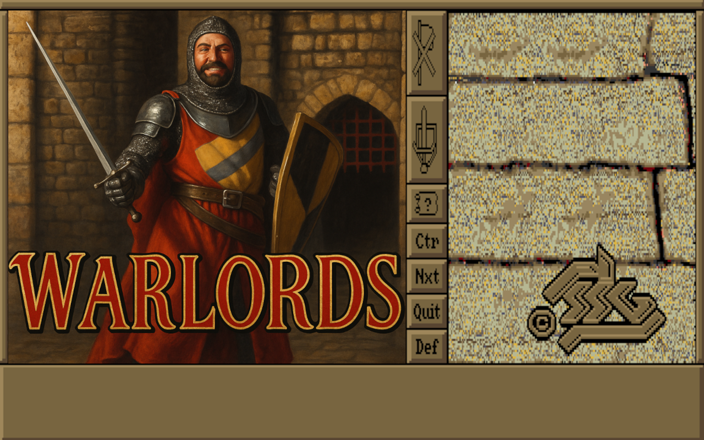
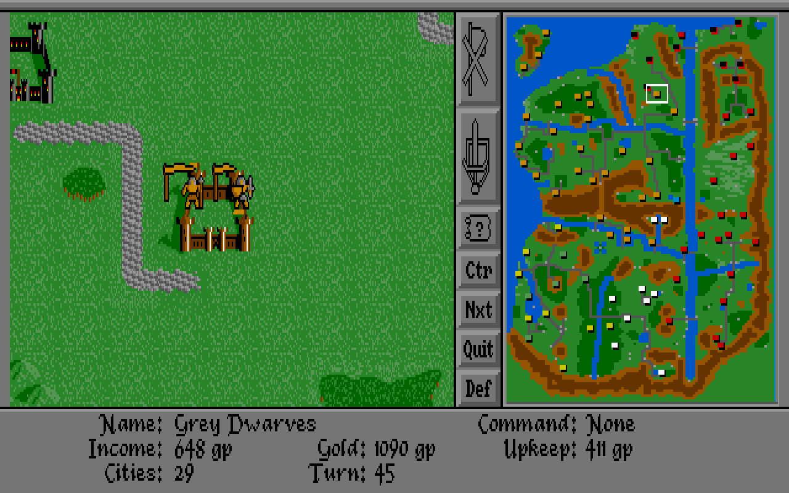

# Warlords



## Current status (October 2026)

**Warlords is playable in Python.** [`pywarlords/`](./pywarlords) is a reimplementation of the DOS game
(version 2.10) in pure Python with [pygame](https://www.pygame.org). The rules, the computer players and
the screens were transcribed from a decompilation of the original `WARLORDS.EXE`.



- **Rules engine:** combat, movement and the original path finder, production and vectoring, the economy,
  heroes and allies, ruins, temples, sages and libraries, towers, razing, surrender offers and victory.
- **Computer players:** Roger Keating's AI, ported at all four levels, including diplomacy and hatreds.
- **Exact randomness:** the original MS C `rand()` is reproduced, so a fixed seed gives the same game.
- **Save files:** original `WAR?.SAV` files load, and games saved in Python load back into DOS Warlords.
- **Screens:** title, setup, main map, strategic map, menus, production, battles, reports, heroes, ruins,
  and save/load.
- **Sound:** the original PC speaker samples, played at the original rates.
- **Platforms:** Windows, macOS and Linux.

No game assets are included. Graphics, the map, unit and city tables, names, palettes and AI tables are
read at start-up from your own copy of the game (see [Getting the Game Assets](#getting-the-game-assets-legally)).

```
pip install pygame numpy
cd pywarlords
python3 -m warlords --data /path/to/your/warlords
```

See [`pywarlords/README.md`](./pywarlords/README.md) for options and controls, and
[`reverse/`](./reverse) for the reverse-engineering notes and rule specifications the code is based on.

Bug reports are welcome, especially from people who remember how the original behaved: AI moves that look
wrong, battle odds, or screens that differ from DOS.


## Motivation

I'm a long-time fan of the original [Warlords](https://en.wikipedia.org/wiki/Warlords_(1990_video_game)) computer game.
This project is a labor of love — my (free time) goal is to gradually bring this brilliant, atmospheric, and tactically rich game back to life, piece by piece.
That includes reverse engineering the original data formats, rebuilding compatible tools, and enabling modern usage, preservation, or modding.
This repository contains my findings, tools, decoders, converters, and now a playable Python port of the game.

A **secondary goal** of this project is to **evaluate how modern AI tools can assist in reverse engineering, restoration, and visualization** of classic software.

The first phase (2025) was interactive AI-assisted analysis: decoding image compression, VGA bitplanes, the map format and tables in the EXE, with AI as a collaborator — not just a calculator.

The second phase (October 2026) went much further. I gave an AI agent ([Claude](https://claude.ai)) the goal *"recreate Warlords from the DOS exe in Python"*.
The agent did the work:

- decompiled `WARLORDS.EXE` with Ghidra
- wrote the specifications in [`reverse/`](./reverse)
- implemented [`pywarlords/`](./pywarlords)
- compared the result with the original running in DOSBox

My part was direction and testing.

It's both an act of restoration and a form of experimentation: **can an enthusiast with curiosity and good AI tooling revive a lost game?**
The answer so far appears to be yes.


## About the Game – *Warlords* (1990)

*Warlords* is a fantasy turn-based strategy game originally released in 1990 for the Amiga and MS-DOS, and later in 1992 for the Macintosh.  
It was designed by [Steve Fawkner](https://en.wikipedia.org/wiki/Steve_Fawkner) and developed by Strategic Studies Group.

Set in the mythical land of **Illuria**, the game features eight clans vying for domination:

- Sirians  
- Storm Giants  
- Grey Dwarves  
- Orcs of Kor  
- Elvallie  
- Horse Lords  
- Selentines  
- Lord Bane

Gameplay centers around capturing cities, producing units, exploring ancient ruins with hero characters, and uncovering relics or allies.
Victory is achieved by controlling at least **two-thirds of the cities** on the map.

Warlords was known for:
- Deep yet accessible strategy
- Surprising replayability
- Atmospheric artwork
- One of the earliest forms of "hotseat" multiplayer on PC

## What's in This Repository

- ✅ [pywarlords](./pywarlords) — the playable Python reimplementation of the game
- ✅ [Reverse engineering notes](./reverse) — memory layout, data tables and rule specifications (combat, movement, economy, exploration, AI) with addresses into `WARLORDS.EXE`, plus the Ghidra scripts and tools used
- ✅ [Decoder](./pck) for `.PCK` files and sprite/image formats
- ✅ [Decoder](./map) for `ILLURIA.MAP` file (the game map) including mapping to graphic tiles from `PICTS/SCENERY.PCK`
- ✅ [Decoder](./fant) for the `FANT` font
- ✅ [Decoder](./exe) for `WARLORDS.EXE` to extract various resources (cities, ruins)
- ✅ [Slicer](./armies) for `PICTS/ARMIES.PCK` to extract individual army unit sprites
- ✅ [PoC](https://ateska.github.io/warlords/) of a Go/WebAssembly application that uses the decoded assets
- [ ] Experimental visualizations and upscalers

All code is open-source, educational, and designed to assist others in understanding or restoring Warlords content.
Contributions welcome!

## Project Goals

- ✅ Decode and document proprietary formats (`.PCK`, `.MAP`, etc.)
- ✅ Reconstruct and visualize in-game assets
- ✅ Extract original VGA palettes and apply them correctly
- ✅ Annotate EXE behavior and sprite routines
- ✅ Rebuild Warlords mechanics with modern tools
- [ ] Polish the Python port until it is indistinguishable from the original
- [ ] (Maybe) Create a lightweight launcher or modding tool

## Why Open Source?

Preserving classic games — not just the playable binaries, but the *creative architecture behind them* — matters.
My hope is that by sharing these tools and notes, more fans, modders, and retro-engineering enthusiasts can contribute or benefit.

If you're interested in collaborating or know something about SSG's formats, let me know!


## Getting the Game Assets (Legally)

To use the tools in this repository and to play `pywarlords`, you'll need the original game files — `WARLORDS.EXE`, `ILLURIA.MAP` and the `PICTS/` folder with the `.PCK` images.
These are **not included here** due to copyright restrictions.

The most reliable and legal way to obtain these assets is by purchasing the game from [GOG.com](https://www.gog.com/).
GOG sells *Warlords 1 + 2 Deluxe* as a DRM-free package, bundled with DOSBox for easy launching.

After installing it, you'll find the game files inside the GOG installation directory — typically:

- **Windows:** `C:\GOG Games\Warlords\`
- **macOS:** `/Applications/Warlords.app/Contents/Resources/game`

Point `pywarlords` at that folder with `--data`, or copy the files into this project folder to inspect or extract content with the decoders.
Original floppy releases work too (the LZEXE-packed `WARLORDS.EXE` is unpacked automatically).

Please support the original creators and rights holders by purchasing a legal copy if you haven't already.


## License

This project is released under the **BSD License**.  
See [LICENSE](./LICENSE) for details.

---

*This is a fan-made project. All original content belongs to their respective copyright holders.*
